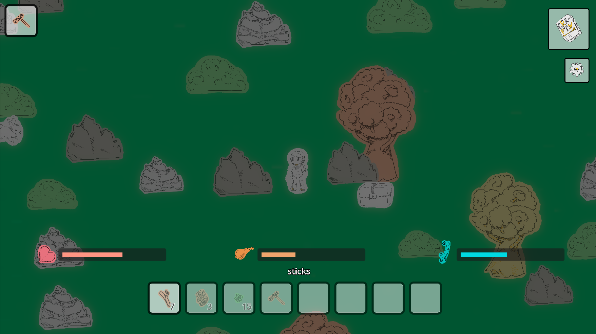
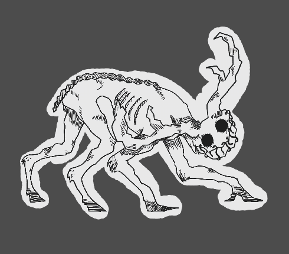

<h1 align="center">Untrusted Forest!</h1>

<h3 align="center">A browser survival game where you must stay alive while finding a way to kill the monster lurking in the shadows.</h3>

<p align="center">
  <a href="https://duc-k.itch.io/untrusted-forest"> Play Untrusted Forest right now! </a>
</p>

<p align="center">
  
  
  
</p>

<p align="center">
  <a href="https://duc-k.itch.io/untrusted-forest">
	
  </a>
</p>

<p align="center">
  <a href="#about">About</a> ·
  <a href="#play">Play</a> ·
  <a href="#controls">Controls</a> ·
  <a href="#features">Features</a> ·
  <a href="#run-it-in-godot">Run in Godot</a>
</p>

---

## About

Untrusted Forest is a survival browser game about balancing hunger, warmth, danger and your inventory.

Every run starts the same way: you have nothing, your inventory is empty, and you spawn at a random point in the forest. To win, you have to get iron tools, use them to break open a chest containing a weapon, and use that weapon to kill the monster lurking in the forest.

The game was made by 2 people participating in the brackeys game jam

## Play

- **Play in your browser:** <a href="https://duc-k.itch.io/untrusted-forest">https://duc-k.itch.io/untrusted-forest</a>
- **Watch some gameplay:** <a href="https://youtu.be/XrrxHqgO_jw">Watch a playthrough on youtube</a>

No download or installation is needed, and the game needs very little processing power.

## Controls

The controls are simple to learn.

| Action                  | Key                               |
| ----------------------- | --------------------------------- |
| Move                    | `W` `A` `S` `D` or the arrow keys |
| Sprint                  | Shift                             |
| Choose inventory slot   | `1` to `8`                        |
| Pick up items           | Walk over items on the floor      |
| Drop equipped item      | `Q`                               |
| Swing equipped item/eat | Left Click                        |

## Features

- **Easy controls:** simple to learn and to start playing fast.
- **Monster:** a monster lurking in the forest trying to kill you.
- **Inventory and item system:** pick things up, carry them, throw them or use them.
- **Crafting system:** many recipes, some of which need a workbench or a furnace.
- **Simple map generation:** The game has an infinite sized map to explore.
- **Multiple status bars:** Always keep an eye on your hunger, warmth and health to keep them in check.

<p>
  
</p>

## Where did the idea for Untrusted Forest come from?

Untrusted Forest is heavily inspired by survival .io games. I remember playing them for hours at a time, which is why my teammate and I made this game for a game jam. Making a survival game of my own is a dream project, and maybe I've already achieved it by making this one.

Wanted to say a quick thank you to all of the people from the game jam who played our game and gave feedback. It was very usefull.

## Run it in Godot

You'll need Godot **4.6 or newer**.

1. Clone this repository:

```
git clone https://github.com/Duckwastakon/brackeysJam.git
```

2. Open Godot, choose **Import**, and select the project folder (the one that contains `project.godot`).
3. Wait a moment while Godot imports the assets the first time.
4. Press `F5` to run the game.

## Project status

The game is finished as it was intended for the game jam.
